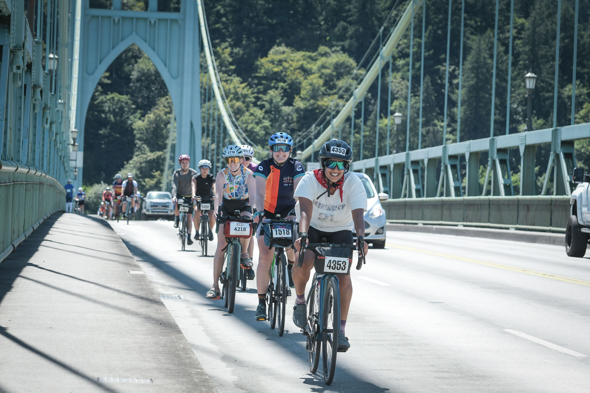
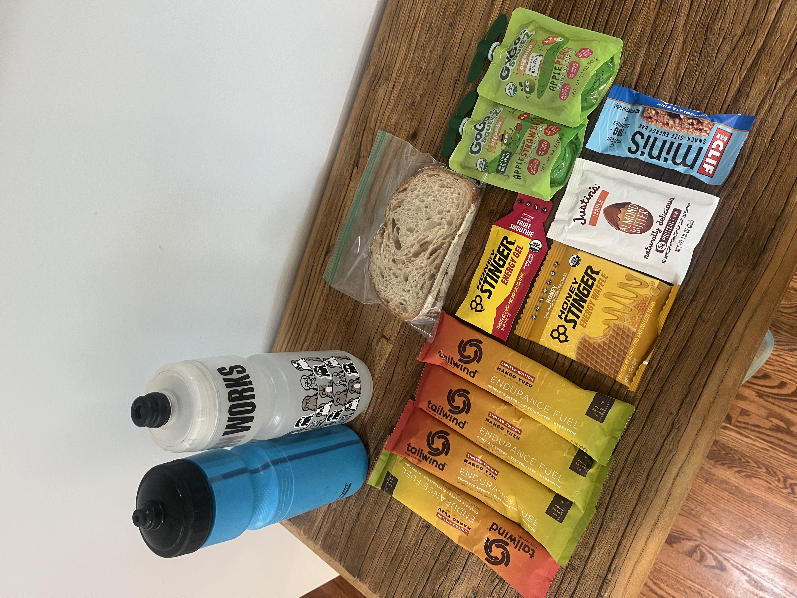

Fueling on the bike isn’t easy. I’ve learned this firsthand after getting into long-distance cycling and completing my first 200-mile event this year.

As a dietitian who has spent more time on her bike than ever before, I’ve developed a deeper passion for helping cyclists meet their nutrition needs (because it can be so hard!). Cycling presents very specific challenges when it comes to eating and drinking. Despite my years of experience as a dietitian and athlete, I was surprised by how difficult it can be to fuel consistently on the bike. Some challenges such as confidence and comfort while riding, limited storage space for food and fluids, access to water, weather conditions, safety considerations, and route logistics can all make adequate fueling all the more difficult. As a result, it’s common for cyclists to unintentionally underfuel for their rides.

Underfueling doesn't always look like completely "bonking" during a ride. Sometimes it shows up as gradually feeling low on energy, difficulty maintaining pace, poor recovery, irritability, headaches, or intense hunger later in the day. Many cyclists assume these experiences are simply part of endurance riding when, in reality, riding can feel better and more enjoyable through intentional fueling that aligns with the effort put in. I am confident that my fueling strategies played a role in me being able to truly enjoy my 200-mile event (along with good friends, good weather, and a Pitbull playlist).

My own experiences and love of cycling inspire my passion for helping others who have navigated similar challenges and want to feel stronger and more confident. I'm excited to support cyclists in a variety of ways, including sharing practical resources, leading group education, and/or providing one-on-one nutrition counseling. Only time will tell how this will all unfold. In the meantime, if you would like to work one-on-one with me to help you spend less time worrying about nutrition and more time enjoying your rides, I'd love to connect and help you get there. - Nicole
