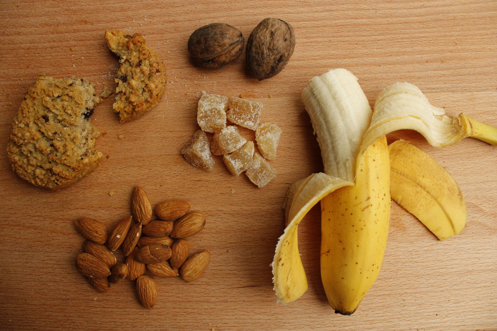

Intuitive eating is a flexible, non-diet approach to eating that emphasizes honoring internal body cues and food preferences to foster a supportive and peaceful relationship with food and your body. If you're not familiar with the concept of intuitive eating, check out our blog, [Intuitive Eating: Moving into Attunement with Your Body](/blog/intuitive-eating-attunement/) for a primer.

It's not uncommon for people to misinterpret the principles of intuitive eating when they first learn about it. Some may think that intuitive eating discourages any form of structured eating and doesn't take into account nutritional science. For these reasons, some individuals with special nutrition considerations, like athletes or those with chronic health conditions, may feel that intuitive eating isn't an option for them. In reality, intuitive eating encourages flexible structure and is adaptable for those with special considerations. In this blog, we'll discuss intuitive eating for athletes and active people.

As an athlete, you probably know that food can play a role in physical and mental well-being and performance. Trying to engage in sport or physical activity without consuming proper fuel (read: food) is like trying to drive a car with an empty gas tank. Unfortunately, diet culture is rampant in sports, which can lead athletes to believe that they must follow rigid and restrictive diets or achieve certain body ideals to perform at their best. Sometimes, coaches and other athletic training staff inadvertently perpetuate these types of harmful nutrition messages too. Athletes are at increased risk of developing disordered eating behaviors and eating disorders, and studies have shown that a higher proportion of athletes struggle with disordered eating/eating disorders compared to non-athletes. According to one study, "the estimated prevalence of disordered eating ranges from 6-45% in female athletes and 0-19% in male athletes." These wide ranges are related to discrepancies in study methodology, such as screening instruments and assessment tools used, as well as different types of sports, varying competition levels, athlete age, and other factors. Regardless, it is clear that athletes are at heightened risk of developing disordered eating patterns. In light of this, it is crucial for athletes to develop a healthy and supportive relationship with food. Enter: intuitive eating.

## Creating a Peaceful Relationship with Food

Two important principles of intuitive eating are to "make peace with food" and "challenge the food police." Incorporating these principles into your life may look like eliminating labels such as "good and bad foods," letting go of rigid food rules, removing morality from food choices, and allowing yourself unconditional permission to eat all foods - yes, all foods! An example of when this framing may come in handy is when an inner (or real life) food critic tries to tell you not to eat simple carbohydrates before a training session or to be conscious of the sugar content in sports drinks. We know that consuming these things, especially around the time of training, supports our bodies and our performance.

## Sensing and Responding to Hunger Cues

Other principles of intuitive eating include "honor your hunger," "feel your fullness," and "discover the satisfaction factor." These principles are all about recognizing and responding to hunger and fullness cues based on your body's needs and preferences. This is foundational to creating a trusting relationship with food and your body. For most athletes, however, it's not as simple as "just eat when you're hungry." You may have a training session at 6 AM and prefer to sleep longer instead of waking up to eat beforehand. Or, you may feel a complete lack of appetite after training in hot weather. Perhaps you have a busy day ahead and don't feel you have time for a recovery snack/meal after your workout. In times like this, it is important to utilize "practical hunger," which may mean eating before, during, and/or after exercise even in the absence of hunger cues because you know that you need fuel for your body. Similarly, you may benefit from eating larger amounts of certain types of food on specific training days (e.g. increased carbohydrate intake on long run days). So, while athletes can and should learn to rely on and respond to physical hunger and fullness cues as is taught in intuitive eating, they also need to integrate proper fueling techniques based on their knowledge or sports nutrition guidance that they've received from a qualified professional.

## Respecting Your Body

An important principle of intuitive eating is "respect your body," understanding that each person has a unique genetic blueprint and is worthy of respect and dignity regardless of body size and shape. Athletes, especially those participating in weight class sports, endurance sports, or sports with an aesthetic component, may feel pressure to obtain an "ideal body" with the hope of improving their performance. There is no evidence supporting a universal body composition target for various sports. Plus, there are dozens of other variables that influence sport performance beyond weight and body composition, such as environmental factors, mental well-being, coaching, sleep, nutrition, and more.

<figure class="post-figure">
            
            <figcaption>Photo by <a href="https://unsplash.com/@32steps?utm_source=unsplash&utm_medium=referral&utm_content=creditCopyText">Merve Sehirli Nasir</a> on <a href="https://unsplash.com/photos/sliced-banana-and-brown-nuts-on-brown-wooden-table-XqgZH6QS3oA?utm_source=unsplash&utm_medium=referral&utm_content=creditCopyText">Unsplash</a></figcaption>
          </figure>

## Implementing Gentle Nutrition

The final principle of intuitive eating is "honor your health with gentle nutrition." Gentle nutrition means nourishing your body adequately and consistently with a variety of foods that taste good and make you feel good. As an athlete, your nutrition needs may be higher than you expect, so it is important to make sure that you are eating enough to support your activity level and training load. Building on a foundation of eating enough, some further things you may consider when making food decisions are: including foods you enjoy, having foods that your body tolerates well, and incorporating foods that offer your body an array of nutrients. Timing your nutrient intake according to training, adjusting portions based on activity level, and utilizing sports nutrition knowledge to fuel appropriately are all ways that athletes can implement gentle nutrition.

As you can see, intuitive eating and eating for performance can coexist. It requires integrating both brain and body knowledge, and relying on practical hunger in certain circumstances. If you're confused about how to fuel for your sport/activity level or want to learn about intuitive eating and sports nutrition, reach out to us at Woven Nutrition to schedule a visit!
